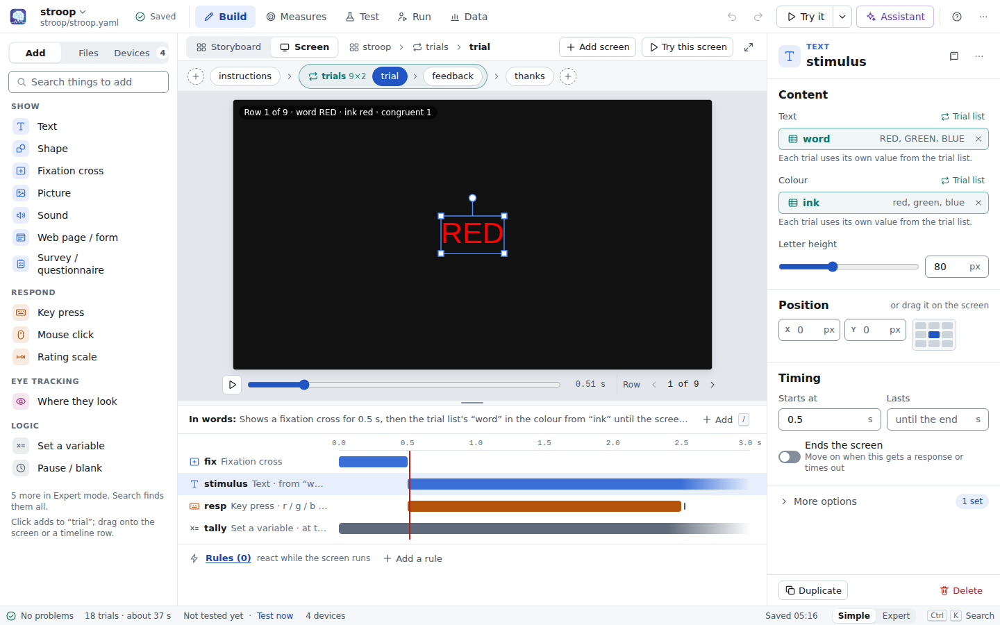

# Builder guide

Double-click the **EDGE** icon, or run `edge` (your experiments folder) or `edge builder [folder]`.
The builder opens in your browser and reads and writes experiment files in that folder. It runs on this
computer: nothing leaves it unless you set up an online [assistant](ASSISTANT.md).

## The layout

| area | what it's for |
|---|---|
| **App bar** (top) | the experiment's name (click it for the **Experiment menu**), the save state, the five workspaces **Build · Measures · Test · Run · Data**, Undo / Redo, **Try it**, **Assistant**, Help (**?**) and **⋯** (Preferences, Keyboard shortcuts, Find connected devices, Check this computer, Make a support bundle, About EDGE) |
| **Status bar** (bottom) | problems (*No problems*, *1 to fix*, *2 to check*), the number of trials and the estimated time, whether the current version has been tested (*Not tested yet · Test now*, *Tested 2 min ago*, *Changed since the last test*), the devices, the save time, **Simple · Expert**, and **Ctrl K Search** |
| **Companion column** (right, optional) | **Assistant** and **Help** as two tabs next to your work. At 1024–1279 px it shares the right column with **Properties** |

The workspaces follow the life of a study, in this order:

| workspace | what you do there |
|---|---|
| **Build** | make the screens and their order: a sidebar (**Add · Files · Devices**), the canvas (**Storyboard · Screen**, and **YAML** in Expert mode) and **Properties** on the right |
| **Measures** | say what the experiment measures, and see everything it records |
| **Test** | *Is it ready?*: Check, Try it yourself, Test run with a virtual participant, device tests |
| **Run** | run a participant: before the session, the live monitor during it, what's next after it |
| **Data** | sessions, trial tables, summaries, what each column means, exports |

The tabs carry their state: Test shows a check mark after a passing test run or a red count of problems,
Run shows a red **recording pill** (participant and time) while a session runs, Data counts the sessions.

## Words used in the builder

| builder | means | in the YAML file |
|---|---|---|
| experiment | one study | the YAML file |
| screen | one step: instructions, a trial, feedback | `routines:` |
| item | a thing on a screen: text, picture, key press … | `components:` |
| storyboard / the experiment's order | what happens in which order | `flow:` |
| trial list (rows, columns) | repeats screens once per row | `loop:` with `conditions:` |
| if / otherwise | shows screens only when a condition holds | `if:` / `then:` / `else:` |
| workflow, phase, route | phases with "then go to…" routes (practice until good, screening) | `statemachine:`, `states:`, `next:` |
| repeat this phase at most N times | | `max_visits:` |
| formula | a value computed while the experiment runs | a value starting with `$` |
| measure (outcome, condition, control, check, info) | what you measure and what it depends on | `measures:` (outcome, factor, covariate, check, info) |
| Try it | you do the experiment inside the builder | (builder only) |
| test run (virtual participant) | an automatic run with simulated hardware | `edge run --dry-run` |
| session | one participant's run | a session folder |
| Must fix · Worth checking · Note | problem levels | error · warning · info |
| History | the saved versions | backups |
| Share as one file (.edgez) | everything the experiment needs in one file | bundle |
| Lock this version | freeze it after piloting | lockfile |

In Expert mode the file term is shown next to the plain word ("Screen · routine").

## Simple and Expert mode

**Simple · Expert** in the status bar (and in Preferences) decides how much you see. Switching never changes the
experiment, the selection or the place you are in. Your choice is remembered.

| | Simple (default) | Expert adds |
|---|---|---|
| Add | Show (Text, Shape, Fixation cross, Picture, Sound, Web page / form, Survey / questionnaire), Respond (Key press, Mouse click, Rating scale; Button box once an input device exists), Eye tracking (once an eye tracker exists), Logic (Set a variable, Pause / blank) | Python code, Event marker, Follow the gaze, Calibrate eye tracker, the hardware items; type ids as captions |
| Properties | the essentials; the rest under **More options** (with the count of options already set) | every property open, YAML keys as captions, frame-based timing, *starts after* / *starts when* / *stops when* |
| Build views | Storyboard, Screen, Trial list, Diagram | + **YAML** (the file itself) |
| Problems | Must fix, Worth checking | + Notes, and the original message under the plain one |
| Experiment menu | everything but the YAML | + Show the YAML, Copy the file path |

Simple hides options, never safety, sharing or import: History, Share as one file, Import, Find connected
devices, Lock and the support bundle are there in both modes. **Search** (Ctrl+K, or the search box in Add)
always finds everything.

## Home

**Home** (click the logo) is where you start and where your experiments are listed.

* **What do you want to build?** **Describe it**: the [assistant](ASSISTANT.md) builds a first version from your
  description and your files (attach a trial list, pictures, a consent page). It shows **Set up the assistant**
  until a model is set up.
* **Answer a few questions** (the design wizard), **Start from an example**, **Blank experiment** and **Import**.
  Each asks for a name first and makes a folder for the experiment.
* **Your experiments**: a list with each experiment's state (*Has data*, *Locked*, *Draft*), its sessions and when
  it was last changed, with **Open**, **Run** and **Data**.
* **Examples** and **Learn by doing** (the interactive tutorials).

## Starting a new experiment

**New experiment…** (Experiment menu) or Home:

* **Describe it** (with the assistant): see [The assistant](ASSISTANT.md).
* **Answer a few questions** is the design wizard. Six pages ask what participants see (and the list of stimuli,
  which you can paste from a spreadsheet), how they respond, the timing, practice (none, once, or until a
  criterion via a workflow) and feedback, blocks and texts, and optional questionnaires and devices. A preview
  shows one trial and a line counts the trials and minutes. **Create and test** saves it in its own folder, opens
  it and runs a test run straight away.
* **Start from an example**: Blank, Free viewing (eye tracking), Auditory oddball (EEG), Timing test for this
  computer, Contrast threshold (staircase), Online questionnaire.
* **Import** from PsychoPy, E-Prime, OpenSesame or jsPsych (see [Importing](IMPORT.md)).

## The storyboard

**Storyboard** (Build) shows the whole experiment as cards, in the order participants see them; it is also where
you change that order. Each card is one screen drawn at the moment its main stimulus is up, with the first row of
its trial list filled in, and a line saying how it ends ("r / g / b · max 2.5 s", "0.6 s").

* **Trial lists** are green frames ("Trial list “trials” · stroop.csv · 9 rows × 2 · shuffled") with
  **Open list**; **if / otherwise** frames are dashed; **workflows** are purple frames with one box per phase
  and **Open diagram**.
* Click a card to select it (Properties shows the screen); double-click (or Enter) opens it in the **Screen** view.
* The round **+** between cards (and **Add a step** at the end) opens **Add here**: New screen, Show an existing
  screen again, Copy of a screen, Trial list (repeat screens for each row), If / otherwise, Workflow (practice
  until good, screening…), and **Describe what goes here…** (the assistant).
* **Add screen** (toolbar) adds a screen at the end and opens it. New screens always join the experiment where
  you make them. Screens that aren't in the experiment are listed under the cards (**Not shown in the
  experiment:** with **Add back** and **Delete**).
* **Drag** a card or a frame onto any **+** to move it, also into or out of trial lists and workflow phases.
  Alt+arrow keys move the selection.
* A card's **⋯** (or right-click) has Open, Rename, Duplicate, Move earlier / later, Repeat with a trial list,
  Show only if…, Remove from the experiment and Delete screen. Removing and deleting show an **Undo** message
  instead of asking first.
* **Cards · List** switches to a compact list for large studies. The toolbar shows the trial count and the
  estimated time.

## Screens and the timeline

The **Screen** view shows one screen: the live **preview** on top, the **timeline** below (drag the line between
them to resize; **Focus** hides the timeline). The flow strip above the preview lists every screen in order;
`[` and `]` go to the previous and next screen.

* Click an item under **Add** to add it to the open screen, or drag it onto the preview (to place it) or onto a
  timeline row. `/` opens **quick add** at the playhead. A new stimulus gets a 1 s placeholder until you add a
  response that ends the screen; then it stays up until the response.
* Each item is a bar: **drag** it to change when it starts, drag its **right edge** to change how long it lasts.
  Faded bars run until the screen ends; a tick marks a response that ends the screen; striped bars start on a
  condition. With a bar focused, ←/→ moves it by 0.05 s (Shift: 0.5 s) and Alt+←/→ changes its length.
* **In words** above the timeline says what the screen does, with formulas translated: *"Shows the trial list's
  “word” in the colour from “ink”, and a fixation cross for 0.5 s. It waits for R, G or B; the response ends the
  screen."* Read it to check your logic; Expert shows the formulas too.
* The preview shows the screen at the time on the slider, with the values of one trial-list row: **Row ◂ 1 of 9 ▸**
  steps through the rows (Ctrl+[ and Ctrl+]). The play button plays it at real speed. Web pages are previewed live.
* **Rules (n) · react while the screen runs** sits under the timeline (see [Rules](#rules)).
* **Try this screen** runs only this screen for five trials, with real values from its trial list.

### Arranging the screen on the preview

The preview is also an editor.

| do this | to |
|---|---|
| click a text, picture or shape | select it (Properties shows it) |
| drag it | move it; it snaps to the centre of the screen and to the centres of other things (hold **Alt** to stop snapping, **Shift** to move in a straight line) |
| drag a corner handle | resize: letter height for text, width × height for pictures and rectangles, the radius for circles. Pictures keep their proportions (hold **Shift** to stretch); shapes stretch freely (hold **Shift** to keep proportions) |
| drag the round handle above it | rotate (hold **Shift** for 15° steps) |
| double-click text | type the text right on the screen (**Enter** to finish, **Shift+Enter** for a new line, **Esc** to cancel) |
| double-click a picture | choose another picture |
| arrow keys (after clicking the preview) | nudge by one pixel; **Shift** for ten |
| drag an item from Add onto the preview | add it exactly there |
| drop picture, sound or .html files from your computer onto the preview | copy them into the experiment folder and add them where you dropped them |

Every change can be undone. If a position or size comes from the trial list, the preview says so instead of
moving it: change it in the trial list, or make the value the same on every trial again.

### Pictures, sounds and pages

Adding a **Picture** or **Sound** opens a chooser straight away. It shows what is already in the experiment's
folder (thumbnails for pictures, a play button for sounds), with a search box. **Upload from computer**, or
dropping files on the chooser, copies them into `images/`, `sounds/` or `pages/` next to the experiment (EDGE asks
for a name first if the experiment hasn't been saved yet). For sounds you can also pick a beep: low, middle,
high, very high or any frequency. In Properties the file shows as a card with a thumbnail; **Change…** reopens the
chooser, and you can drop a file on the card.

The **Files** tab of the sidebar lists the pictures, sounds, web pages and trial-list files in the experiment's
folder, with where each one is used (or *not used*). **Add files** uploads more; a table's **⋯** offers **Use as a
trial list…** and **Use with the assistant**.

## Properties and where values come from

**Properties** (right) edits whatever is selected: an item, a screen, a trial list, an if / otherwise, a
workflow or phase, a device. With nothing selected it shows the experiment overview: its description, the
estimate, a **Next steps** checklist (Build your screens · Try it yourself · Say what you measure · Start a test
run · Save · Run a pilot participant), the window and **Experiment settings…**.

An item's properties come in sections: **Content**, **Position**, **Timing** (*Starts at*, *Lasts*, the switch
**Ends the screen**: *Move on when this gets a response or times out*) and **More options** (with the number of
options already set). The book button opens the help for that kind of item; **⋯** has more actions.

Next to a field's label, a small button says where the value comes from (in Simple mode it shows when you point
at the field, or when the value isn't fixed). Its menu, **Value comes from**:

| choice | what it does |
|---|---|
| **Same on every trial** | a fixed value (the button reads *Fixed*) |
| **From the trial list** ▸ a column | each trial uses that column of the trial list around this screen; the field shows the column with an example value, and clicking it opens the trial list at that column. × makes it fixed again |
| **New trial-list column…** | asks for a name and adds the column to the trial list around this screen, filled with the current value. If the screen has no trial list yet, EDGE puts it into a new one with two rows |
| **Formula ($…)** | an expression, computed while the experiment runs. Suggestions list what's available here: columns, results of other items (`$resp.corr`), trial-list statistics (`$practice.accuracy`), workflow state, variables. A sentence under the field says it in words |

Fixed values have editors that fit them:

* **colours**: a row of swatches, a colour picker for any other colour, or type a name or `#hex`; fills and
  outlines have a "none" swatch.
* **numbers with a range** (opacity, rotation, letter height, line thickness, volume …): a slider that updates the
  preview as you drag, next to a box for exact values.
* **position** and **size**: X/Y or W/H boxes. Drag the letter (X, Y, W, H) sideways to change the value (Shift for
  bigger steps). The small 3×3 grid puts the item in a standard place (centre, top left, bottom right …). A
  picture's size keeps its proportions while the lock is on, and has **Original size**, ½×, ¾×, 1½× and 2× buttons.
* **keys**: chips; click the box and press the keys to add them, Backspace removes the last one.
* **shape** and other short choices: buttons with icons.
* **font**: a menu of common fonts, each shown in its own typeface, and **Other…** for any font.

Under **More options**: *starts after* another item, *starts when* / *stops when* a condition, frame-based timing
(Expert), and **Only if** (include the item only when a condition is true).

A **screen**'s properties: **Name**, **Lasts at most** (empty: *until a response*), **Notes**, **How it ends**
(in words) and **Rules**.

## Trial lists

Select a trial list's green frame to set how it runs in Properties: **Order** (*As listed*, *Shuffled each
time*, *Shuffled across repeats*, *Latin square by participant number*, *Counterbalanced by participant number*)
and **Repeat the list N times**, with the number of trials it makes. Under More options: **No more than N in a
row** (per column), **Use only rows** and **Stop early when**. **Remove the trial list, keep its screens** is at the
bottom.

**Open list** (or double-click the frame's title) opens the **trial list view** on the whole canvas. **Rows come
from**:

* **Typed here**: a grid that works like a spreadsheet: arrows and Tab move, type or Enter edits, **+ Row** adds a
  row, the column header menu renames, inserts and deletes columns, and **Paste from Excel** (or Ctrl+V) pastes
  rows copied from Excel, LibreOffice or Google Sheets. Each column header says which items use it, or *not used:
  for analysis*.
* **A file**: a CSV, TSV or Excel file from the experiment's folder, shown read-only; **Change file…** and **Copy
  into the experiment** (turns it into typed rows).
* **Every combination**: list each factor and its levels; EDGE builds every combination ("3 × 3 = 9 rows").
* **Staircase**: an adaptive procedure (start value, steps, how many right answers make it harder, when to stop).

**Done** (or Esc) goes back to where you came from.

## Workflows and if / otherwise

A **workflow** runs **phases** one at a time; after a phase, its **routes** (*Then go to…*) decide what comes next,
checked from top to bottom: *When* a condition holds go to that phase; an empty *When* means *Otherwise*. **Repeat
this phase at most N times** stops a phase from repeating forever (practice until good, at most 3 times). Put
screens and trial lists into a phase with its **+** or by dragging them there.

Select the workflow's frame to set the first phase and add phases; click a phase name to edit its routes. **Open
diagram** shows the phases and routes as a diagram (solid arrows have conditions, dashed ones are *otherwise*);
click a phase there to edit it, **Done** goes back.

An **if / otherwise** frame shows its screens only when a condition holds, with an optional *otherwise* lane.
Its Properties edit the condition (with a sentence under it) and offer to remove the condition but keep its
screens. **Show only if…** on a card does the same for a single screen.

### Rules

**Rules · react while the screen runs** (in a screen's Properties, and under its timeline): *when* a condition
becomes true (once, or every time it becomes true), *do* actions: end the screen, start or stop an item, set
variables, send a marker, go to a workflow phase, or write to the log. For example: when `$t > 1.5 and resp.keys is
None`, start the item *hint*.

## Measures & data

**Measures** answers two questions: *what does this experiment measure?* and *what exactly is recorded?*

* **What this experiment measures**: one card per measure: a name, its role (**Outcome**, **Condition**,
  **Control**, **Check**, **Info**), the column it comes from, how it is summarised, which trials count (*use
  trials of …*, *only when …*, e.g. correct trials only) and the range you expect. Each card says it in plain
  words and shows problems right there. Experiments without measures get suggestions (**Add all** takes them);
  the design wizard declares them for you, and **Suggest measures for my question** asks the assistant.
* **Everything that is recorded**: participant info, trial-list columns, every screen's items with the columns
  they record (meaning, units, kind), variables, and each device's streams (channels, sample rate, file) or what it
  sends elsewhere (TTL codes, LSL markers). Untick an item or device to stop saving it; the star turns any column
  into a measure (a trial-list column becomes a condition, `resp.rt` a reaction time on correct trials, `resp.corr`
  an accuracy). Timing columns are folded under **Timing details** in Simple mode.

### Live session monitor

While a session runs, the **Run** page shows:

* progress: trial *n* of about *N*, time elapsed and left;
* each measure: its value so far (median RT, % correct, mean rating …), how many trials it is based on and how
  many are missing, and a small chart of every trial (the expected range shaded, values outside it and missing
  ones marked);
* the last response: what was pressed, how fast, correct or not, in which condition;
* every device stream: samples per second against its nominal rate, green / amber (too slow) / red (no data);
* warnings: *no response on the last 5 trials*, a measure missing on more than 20 % of trials, values outside the
  expected range, a device that went silent;
* **Stop session** ends it like Esc in the experiment window: everything so far is saved.

You can work elsewhere in the builder meanwhile: the red recording pill on the **Run** tab brings you back.

## Surveys and questionnaires

**Survey / questionnaire** (under *Show*) adds a questionnaire page; if the open screen already has something on
it, the survey gets its own screen after it (with an **Undo** in the message). **Edit questions** in Properties
opens the survey editor: questions on the left (drag to reorder, duplicate, delete, page breaks), the selected
question in the middle (text, data name, options or a standard scale, required, shuffle, "other, please
specify", limits, validation, **Show it** for display logic), and the real participant page live on the right.
**From the library** adds validated questionnaires with their citation, licence and scoring; **Customize** copies a
library questionnaire's items in for editing. See [Surveys](SURVEYS.md).

## Checking, testing and trying

* **Check** runs while you edit. The status bar says *No problems* or how many there are; click it for the
  **Problems** list: **Must fix**, **Worth checking** (and **Notes** in Expert), each with where it is and
  **Go there** (and **Ask the assistant** when the assistant is set up). Messages are in plain words: *"The trial
  list has no column called “inkk”. Did you mean “ink”?"*. Things that simply aren't done yet (an empty experiment, a
  screen with nothing on it) are listed as **Still to do** instead of errors.
* **Test** › **Is it ready?** lists what's done and what's left (no problems, a passing test run, tried it yourself,
  measures, device tests, this computer's timing, locked after piloting), each with a link to the place that does it.
* **Start test run** (Test page, **Test now** in the status bar, the Try it menu, or Ctrl+Shift+Enter): a virtual
  participant does the whole experiment in seconds, with every device simulated. **Last test run** shows the
  session length, the number of trials, accuracy, the verdict, the measures, streams and synchronisation per
  device, and a data preview; **Open in Data** shows all of it.
* **Try it** (top right, Ctrl+Enter): you do it. The main button tries the whole experiment; its menu has **Try only
  “<screen>” (5 trials)** with real values from the trial list, **Start a test run** and **Check for problems
  now**. The experiment runs with the real engine and fills the window; press keys and click as a participant
  would, **Esc** stops. Web pages (consent forms, questionnaires) appear in place. At the end you see your trials,
  accuracy and mean response time, with **Try again**, **See this data** and **Back to editing**. The data is saved
  under **Tests & tries** on the Data page. Times measured in a browser are approximate: use Run for real data.

## Run with a participant

**Run** prepares and runs a real session in the experiment window on this computer:

* **This session**: **Participant ID** (the next free number is suggested; reusing an ID is allowed, with a
  warning), **Session**, and the participant info you ask for.
* **Devices**: **Real devices** or **Simulated** (when no hardware is connected). **Screen**: **Full screen** or
  **In a window**.
* **What will be recorded** (with **Review measures**) and **Before you start**: the pre-flight check, *GO: ready
  for participants* or *NO-GO: not ready yet* with the reasons and **Go there**.
* **Start session** (or **Save and start** when there are unsaved changes). While an assistant preview is open,
  apply or discard it first.

During the session the page becomes the [live monitor](#live-session-monitor). Afterwards **See the data** opens
the session on the Data page, and **Next participant** starts over with the next ID. If the window can't open (no
monitor, a missing library) or a device can't be reached, the page says so in plain words.

## Data

**Data** lists the sessions of this experiment: **Participants**, **Tests & tries** (test runs and your own tries)
or **All**. Click a session for its **Trials** table, the **Summary** per condition and **What each column means**.
**Export** writes this session as CSV, Excel, TSV, JSON or BIDS; **Export all sessions** merges every participant
into one table (CSV + Excel) or one BIDS folder. A message says where the files went (**Show the files**). See
[Data](DATA.md).

## Devices

The **Devices** tab of the sidebar lists the devices with their last test. **Add device** opens a dialog grouped by
kind (Eye tracker, EEG / physiology, Response box & inputs, Send triggers to…, Marker stream, Simulated (for
testing)), with a search box. **Find connected devices** (also in **⋯**) finds connected LSL streams, serial ports,
Tobii trackers and Gazepoint, each with **Add**. Select a device to set it up in Properties, with **Test this
device** and **Use the simulator**. Simulated devices (`sim_eyetracker`, `sim_eeg`, `sim_physio`, `mouse_gaze`) let
you build without hardware; test runs and Try it simulate every device automatically. See [Devices](DEVICES.md).

## Experiment settings

**Experiment settings** (the sliders button in the Build toolbar, the Experiment menu, or the experiment overview)
has **General** (name, description), **Screen** (size of the experiment window, monitor, background, units),
**Participant info** (fields asked when a session starts), **Data files** (folder, session folder name, **Also save
as** Excel, TSV, BIDS …), **Markers** and **Variables** (Expert), and **Reproducibility** (lock, verify, support
bundle). Changes apply as you make them; Undo reverts them.

## The assistant

**Assistant** (top right, Ctrl+I) opens the assistant next to your work: describe a change or a whole
experiment in your own words, attach your files, and review the result as a preview before you **Apply** it (one
step that **Undo** reverts). It runs on Claude (Anthropic), an OpenAI-compatible service, or locally with Ollama or
LM Studio. See [The assistant](ASSISTANT.md) and the tutorial *Build with the assistant*.

## Saving, history and sharing

* **Save** (Ctrl/⌘+S, or click **Unsaved changes**) writes the file safely; a new experiment asks for a name and
  gets its own folder. The previous version is always kept: **History…** (Experiment menu) lists the versions with
  what made them ("Saved by you", "Assistant: add practice block") and restores any of them; `edge backups` does
  the same in a terminal.
* If the file is changed elsewhere (another window, a text editor, Claude via MCP), the builder reloads it when you
  have no unsaved changes; otherwise a strip under the app bar asks which version to keep (the other one is backed
  up either way).
* Unsaved changes survive a browser crash: a strip offers to restore them next time.
* **Share as one file (.edgez)** (Experiment menu) downloads a file with the experiment and every file it uses,
  ready to send to a colleague (`edge unbundle file.edgez`, or **Import** it).
* **Lock this version** (Test page, Experiment settings › Reproducibility) freezes it after piloting.

## Help and tutorials

* **?** opens **Help** in the companion column: search, *About what you're looking at* (help for the open
  workspace and selection), **Learn by doing** (the interactive tutorials) and the guides. The expand button opens
  the full reader. The book button next to a field opens the help for that field.
* Tutorials run *in* the builder: the coach points at what to use (it never covers it), shows **First open …** with
  **Take me there** when it's in another workspace, and moves on when you've done the step. **–** minimises it to
  the status bar. Each tutorial switches to the mode it was written for; finished tutorials are ticked.

## Keyboard shortcuts

| keys | action |
|---|---|
| Ctrl/⌘ K | search everything: screens, items, actions, help, and *Ask the assistant* |
| Ctrl/⌘ I | open the assistant (the selection becomes what you ask about) |
| Ctrl/⌘ S · Ctrl/⌘ Shift S | save · save a copy |
| Ctrl/⌘ O | open an experiment |
| Ctrl/⌘ Z · Ctrl/⌘ Shift Z | undo · redo |
| Ctrl/⌘ Enter | Try it (this screen in the Screen view); in an assistant preview: Apply |
| Ctrl/⌘ Shift Enter | start a test run |
| Alt 1 … 5 | Build, Measures, Test, Run, Data |
| Enter · Esc | open the selection · go back up / close / stop Try it |
| [ · ] | previous · next screen |
| Ctrl/⌘ [ · Ctrl/⌘ ] | previous · next trial-list row in the preview |
| / | quick add (Screen view) |
| F2 · Ctrl/⌘ D · Delete | rename · duplicate · delete the selection |
| Alt + arrow keys | move the selection in the storyboard |
| arrow keys · Shift + arrow keys | preview: nudge by 1 or 10 pixels; timeline bar: move by 0.05 or 0.5 s |
| ? · F1 | Help · help for the focused field |

**⋯** › **Keyboard shortcuts** lists them all.
