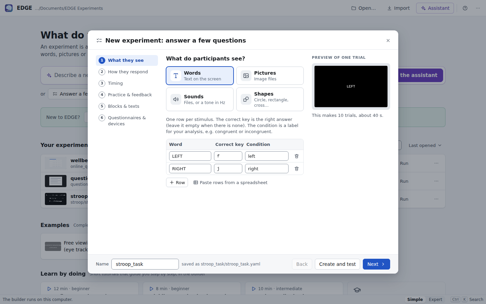
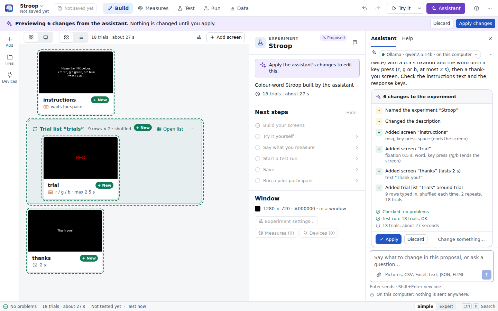

# Getting started

This page takes you from nothing to a tested experiment in about 15 minutes. No programming needed.

## 1. Install

The installers need **Python 3.10 or newer** (they tell you where to get it if it's missing). They make
a private environment in `~/.edge`, so nothing else on your computer changes, and they put an **EDGE**
icon on your desktop.

| You have | Do this |
|---|---|
| **macOS / Linux** | in a terminal: `curl -fsSL https://raw.githubusercontent.com/hfelabs-boop/edge/main/install/install_edge.sh \| sh` |
| **Windows** | in PowerShell: `irm https://raw.githubusercontent.com/hfelabs-boop/edge/main/install/install_edge.ps1 \| iex` |
| A downloaded copy of EDGE | run `install/install_edge.sh`, or right-click `install/install_edge.ps1` → *Run with PowerShell* |

To update later, run `edge update` (or double-click `update.bat` on Windows / run `sh update.sh` on macOS and Linux
if you have the EDGE folder): it downloads the newest version and installs it, and never touches your
experiments or data. More options are in [install/README.md](../install/README.md).

<details><summary>Installing with pip instead (for Python users)</summary>

```bash
git clone https://github.com/hfelabs-boop/EDGE.git
cd EDGE
pip install -e ".[all]"
edge desktop-shortcut        # optional: the EDGE icon
```

`[all]` adds the experiment window (pyglet), Lab Streaming Layer, serial trigger boxes and the
MCP server. Extras you might also want:

| extra | for |
|---|---|
| `pip install -e ".[tobii]"` | Tobii Pro eye trackers |
| `pip install -e ".[html]"` | showing HTML pages in a native full-screen window (otherwise the browser is used) |
| `pip install -e ".[export]"` | Parquet and MATLAB exports |

`edge --version` and `edge devices` check the installation.
</details>

## 2. Open EDGE

Double-click the **EDGE** icon (or type `edge` in a terminal). The builder opens in your browser on your
experiments folder, `EDGE Experiments` in your Documents folder (in your home folder if there is no
Documents folder). It runs on this computer: nothing leaves it unless you set up an online assistant.

You start on **Home**: *What do you want to build?* Below it are your experiments, the examples and the
tutorials (**Learn by doing**). An experiment is a series of screens shown in order; a trial list repeats
screens with different words, pictures or sounds. You test it, run it with participants, and look at the data.

## 3. Make an experiment by answering questions

On Home, click **Answer a few questions** and give the experiment a name. Six short pages ask:

1. **What participants see**: words, pictures, sounds or shapes, and the list of stimuli (one row each,
   with the correct key and a condition label; you can paste them from a spreadsheet).
2. **How they respond**: a key press, a click, a rating scale, or nothing.
3. **Timing**: fixation cross, how long the stimulus stays, the response time limit, the pause between trials.
4. **Practice and feedback**: no practice, practice once, or *practice until good enough* (e.g. 80%
   correct, at most 3 rounds), and whether to show "Correct!" / "Wrong".
5. **Blocks and texts**: number of blocks, repeats, order, break text, instructions, goodbye.
6. **Questionnaires and devices** (optional): consent, demographics and validated questionnaires
   (PHQ-9, Big Five, NASA-TLX …, see [Surveys](SURVEYS.md)); eye tracker, EEG, LSL markers, trigger box
   (simulated until you connect real ones).



A preview shows one trial and the bottom line updates as you go: *"This makes 64 trials, about 6 minutes"*.
Press **Create and test**: EDGE writes the experiment into its own folder, opens it, and immediately runs a
**test run** with a virtual participant to prove it works.

Prefer the terminal? `edge wizard` asks the core questions: the stimuli and how participants respond,
fixation, stimulus duration and deadline, feedback, practice, blocks and repeats, and questionnaires.
It does not ask about devices, the pause between trials, the order or the texts, and its defaults are
simpler (one block, no practice); change those afterwards in the builder. It doesn't run the test run
for you: it prints the command (`edge run <file> --dry-run`), with a note on anything it filled in,
adjusted or left out (example stimuli, stand-in pictures, sound files you still have to add).

## 4. Or describe it to the assistant

The **assistant** builds and changes experiments from a description in your own words, with the files you
already have (a trial list in Excel or CSV, pictures, a consent page). It is optional: everything else in EDGE
works without it. Set it up once, in **Assistant settings** (click **Assistant** at the top right, then **⋯** ›
**Assistant settings**, or **Set up the assistant** on Home). Choose where it runs:

| | what you need | |
|---|---|---|
| **Claude (Anthropic)** | an API key | the best results; online |
| **OpenAI-compatible** | the service (OpenAI, OpenRouter …) and an API key | online |
| **Ollama** | the Ollama app and a model | free; runs on this computer, nothing leaves it |
| **LM Studio** | the LM Studio app and a loaded model | free; runs on this computer, nothing leaves it |

* **Claude with an API key**: sign in at [console.anthropic.com](https://console.anthropic.com), open **API keys**,
  create a key and copy it (it starts with `sk-ant-`). In Assistant settings choose **Claude (Anthropic)**,
  paste the key, keep the suggested model, press **Test connection**, then **Save**. The first time, EDGE shows
  what is sent online; press **Continue**. The key is stored only on this computer.
* **Ollama**: install it from [ollama.com/download](https://ollama.com/download) and start it, then download a
  model that can use tools, in a terminal: `ollama pull qwen2.5:14b`. In Assistant settings choose **Ollama**,
  press **Refresh**, pick the model, **Test connection**, **Save**.
* **LM Studio**: install it, download a model that supports tool use (e.g. a Qwen 2.5 14B Instruct), load it with
  a context length of 16 384 or more, and switch the local server on (**Developer** tab). In Assistant settings
  choose **LM Studio**, pick the model, **Test connection**, **Save**.

Small local models (7–8 B) manage single changes; to build whole experiments from a description use a 14 B or
larger model, or Claude.



Then describe what you want, on Home (**Describe it**, then **Build it**) or in the Assistant panel next to an open
experiment, for example *"A Stroop task: colour words in red, green or blue ink; press R, G or B for the ink
colour. Practice until 80 % correct, then 2 blocks of 36."*

* **Attach files** (the paper clip, or drop them on the panel): they are copied into the experiment's folder
  (`conditions/`, `images/`, `sounds/`, `pages/`, `materials/`), so the experiment can use them.
* The assistant checks and test-runs what it made. The result opens as a **preview**: new and changed screens
  are marked, and nothing is changed until you press **Apply** (or **Discard**).
* **Apply** is one step: **Undo** (in the panel, or Ctrl+Z) brings back the experiment exactly as it was.

[The assistant](ASSISTANT.md) explains every setting, what is sent where, and what to do when something goes
wrong. No model? *Answer a few questions* builds the same kind of experiment without one.

## 5. Look at it, try it

* **Build** › **Storyboard** shows every screen in order as a picture, with trial lists drawn as green frames
  ("Trial list “trials” · 8 rows × 2 · shuffled"). Double-click a screen to open it.
* **Try it** (top right) runs the experiment right in the builder: press the keys and click like a participant
  would. At the end you see your accuracy and response times. Its menu also tries only the open screen for five
  trials.
* **Test** › **Start test run** (or **Test now** in the status bar) lets a virtual participant do the whole
  experiment in seconds, with every device simulated on its own drifting clock, and shows the data it produced.
* The status bar says *No problems*, or how many there are: click it for the list, in plain words, e.g. *"The trial
  list has no column called “inkk”. Did you mean “ink”?"*, each with **Go there**.

## 6. Change it

Select something on a screen (a text, a picture, a key press) and edit it in **Properties** on the right. Next
to each field, a small button says where the value comes from:

* **Same on every trial** (it reads *Fixed*).
* **From the trial list**: a different value on each trial, taken from a column of the trial list (e.g. `word`).
* **New trial-list column…**: makes the column for you (and a trial list, if the screen has none).
* **Formula ($…)**: for experts, e.g. `$f'Score: {score}'`, with a sentence under it that says it in words.

Rarely needed properties are folded under **More options**. **Simple · Expert** in the status bar shows every
option and the YAML file when you want them. Or ask the assistant: select the item and say *"make this bigger"*.

## 7. Run it with a participant

Open **Run**. EDGE suggests the next free participant ID; choose the session, **Real devices** or **Simulated**,
and **Full screen** or **In a window**. **Before you start** says whether it is ready (*GO* or *NO-GO*, with the
reasons). **Start session** opens the experiment window and records; the Run page shows a live monitor. Press
**Escape** in the experiment window (or **Stop session**) to stop early; everything so far is saved. When it's
done, **See the data** opens the trial table, the summary per condition, and exports for Excel, SPSS/R (CSV) and
BIDS.

From a terminal it's the same:

```bash
edge run study.yaml -p 001 -s 1          # participant 001, session 1
edge report study.yaml                   # its newest session: timing and synchronization check
edge export data/ --formats csv,xlsx     # one table for all participants
```

## 8. Learn more

* **Interactive tutorials**: on Home (**Learn by doing**) or under **?**. Start with *Your first experiment*,
  which builds a Stroop task by hand in about 12 minutes and explains every part; *Build with the assistant*
  shows the assistant.
* [Tutorials](TUTORIALS.md): trial lists, workflows (practice until criterion), eye tracking,
  questionnaires, rules, data, importing, the assistant.
* [Builder guide](BUILDER_GUIDE.md): every part of the builder.
* [Cookbook](COOKBOOK.md): ready-made solutions to common design problems.
* [Devices](DEVICES.md): connecting eye trackers, EEG and physiology.
* [The assistant](ASSISTANT.md) and [MCP](MCP.md): build experiments from a description, in the builder or from
  Claude Code and VS Code.

## The five ideas behind EDGE

1. A **screen** is one step: a trial, an instruction page, feedback. (In the file it's called a
   *routine*.) It contains **items** (text, pictures, sounds, key presses, gaze areas, markers …)
   placed on a timeline.
2. The **storyboard** puts screens in order (in the file: the *flow*). A **trial list** (a *loop*) repeats
   screens, once per row; each column (`word`, `ink`) can be used as a value. **If / otherwise** and
   **workflows** decide what happens next.
3. A value starting with **`$`** is a **formula**, computed while the experiment runs:
   `$word`, `$resp.rt < 0.5`, `$f'Score: {score}'`.
4. **Devices** (eye trackers, EEG, physiology, LSL, TTL) are recorded and synchronized automatically.
   A **marker** reaches all of them at the moment the stimulus appears.
5. Everything is a plain **YAML file**, readable and versionable. The builder, the assistant, the command line
   and Claude (via MCP) all edit the same file.
